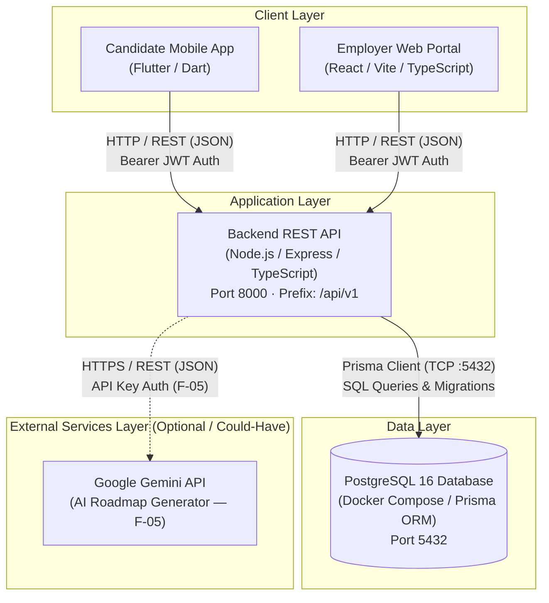

# Phase 3.2 — System Architecture Map

**Objective:** Show the parts of your system, what each one is responsible for, and how data moves between them. No application code yet; this is the plan.

**Status:** Submitted · **Last updated:** 2026-11-03

## Done When

- [x] The diagram shows every part you will build or run, plus every external service from Phase 3.1
- [x] The diagram displays on GitHub
- [x] Every box in the diagram has a row in the component table
- [x] One Must-Have flow is traced from start to finish, including what happens when a step fails

## 1. High-Level Component Map

The diagram below maps all client applications, backend services, persistent storage, and external integrations in SkillBridge. Both candidate and employer clients communicate with a single unified Node.js/Express REST API over HTTP, which connects directly to the PostgreSQL database via Prisma ORM.

Mermaid Diagram Source

## 2. Components

| Component | Responsibility | Technology | Runs when | Talks to |
|---|---|---|---|---|
| **Candidate Mobile App** | Candidate client UI for authentication, Student Profile management (skills, projects), browsing curated Job Listings, triggering automated Skill Gap analysis, bookmarking jobs, viewing Preparation Hub guides, and submitting Job Applications. | Flutter (v3.41.x) with Dart | On-demand on candidate mobile device or Android/iOS emulator | Backend REST API (via HTTP/REST) |
| **Employer Web Portal** | Recruiter desktop UI for employer authentication, company profile management, publishing and managing entry-level Job Listings with explicit skill requirements, and reviewing student applicants with their calculated skill match scores. | React (v18.x) + Vite + TypeScript (v5.x) | On-demand in desktop web browser | Backend REST API (via HTTP/REST) |
| **Backend REST API** | Central application controller. Handles route dispatching (`/api/v1`), JWT authentication and role-based authorization (`CANDIDATE` vs `EMPLOYER`), input validation, business logic (Skill Gap comparison engine), and database operations. | Node.js (v22.x), Express (v4.x), TypeScript (v5.x) | Continuously as a daemon on port 8000 | PostgreSQL 16 Database (via Prisma ORM), Google Gemini API |
| **PostgreSQL 16 Database** | Persistent relational storage for user accounts, candidate profiles, skills, company profiles, job listings, bookmarks, and job applications. | PostgreSQL 16 via Docker Compose container | Continuously in Docker background (`docker compose up -d`) on port 5432 | Backend REST API (Prisma Client) |
| **Google Gemini API** | Generates dynamic, step-by-step AI Learning Roadmaps for students seeking to bridge identified skill gaps (Could-Have feature F-05). | Google AI Studio REST API | Triggered on-demand when student requests an AI roadmap | Backend REST API only |

### Secrets & Database Access Security Policy

All secrets (including database connection string `DATABASE_URL`, JWT signing key `JWT_SECRET`, port configuration `PORT`, and optional `GEMINI_API_KEY`) reside exclusively in a server-side, git-ignored `.env` file on the backend host. Only the Backend REST API has network access and credentials to directly reach the PostgreSQL database container over port 5432. Neither the Flutter mobile app nor the React web portal has database credentials or direct database connections; every client interaction must authenticate through the backend's `/api/v1` REST endpoints.

## 3. Flow Trace

Flow traced: **Candidate Applies to a Job with Automated Skill Fit Verification (Serving F-03, F-06, and UJ-07)**

| Step | Where | What happens |
|---|---|---|
| 1 | Candidate Mobile App | Sokha views a Job Listing with matching and missing skills and taps the **"Apply Now"** button. The app reads the stored JWT token and issues an HTTP request: `POST /api/v1/jobs/:id/apply` with header `Authorization: Bearer <token>`. |
| 2 | Backend REST API (Auth Middleware) | The API intercepts the request, decodes and verifies the JWT signature against `JWT_SECRET`, and verifies that the user role is `CANDIDATE`. *Failure case:* If the token is missing or expired, the API immediately responds with `401 UNAUTHORIZED`. If the user has an `EMPLOYER` role, it responds with `403 FORBIDDEN`. |
| 3 | Backend REST API (Validation & Duplicate Check) | The API queries the database to ensure the Job Listing exists and is active. It also queries the `JobApplication` table for any existing record with `student_id = current_user.id` and `job_listing_id = :id`. *Failure case:* If the job does not exist, the API returns `404 NOT_FOUND`. If an application already exists, the API returns `409 CONFLICT` (`{"error": {"code": "ALREADY_APPLIED", "message": "You have already applied for this job listing"}}`). |
| 4 | Backend REST API (Skill Gap Calculation Engine) | The API retrieves the candidate's skills from `StudentProfile` and compares them with the job's required skills from `JobListing`. It computes the matching skill count, missing skill list (Skill Gap), and match score percentage (`match_percentage = (matched_skills / total_required_skills) * 100`). |
| 5 | PostgreSQL Database (Prisma ORM) | The API opens a transaction and creates a new `JobApplication` record with `student_id`, `job_listing_id`, `match_score`, `status = "SUBMITTED"`, and timestamps. The record is committed. *Failure case:* If the database connection drops or a constraint fails, the transaction rolls back and the API returns `500 SERVER_ERROR`. |
| 6 | Backend REST API → Mobile App | The API sends an HTTP `201 CREATED` response containing the created application payload: `{"id": "...", "status": "SUBMITTED", "matchScore": 80, "appliedAt": "2026-11-03T..."}`. |
| 7 | Candidate Mobile App | The Flutter mobile app receives the `201 CREATED` response, updates the job details screen state by switching the "Apply Now" button to a disabled "Applied" state, and presents a success confirmation snackbar to the candidate. *Failure handling:* On network error or any HTTP error status (400, 401, 409, 500), the app displays a clear user-facing error message and leaves the button operable or in its accurate current state. |
