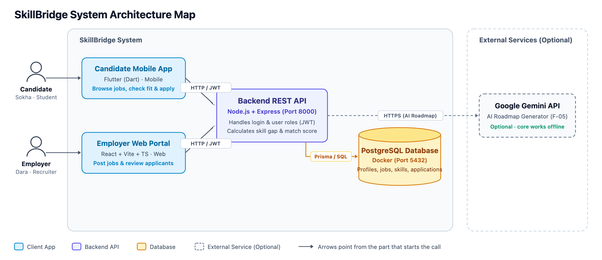
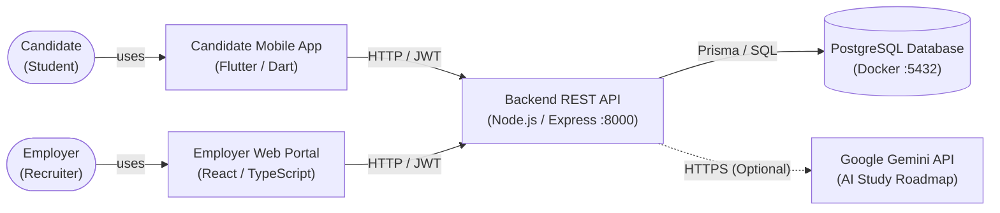

# Phase 3.2 — System Architecture Map

**Objective:** Show the parts of your system, what each one is responsible for, and how data moves between them. No application code yet; this is the plan.

**Status:** Submitted · **Last updated:** 2026-11-03

## Done When

- [x] The diagram shows every part you will build or run, plus every external service from Phase 3.1
- [x] The diagram displays on GitHub
- [x] Every box in the diagram has a row in the component table
- [x] One Must-Have flow is traced from start to finish, including what happens when a step fails

---

## 1. High-Level Component Map

SkillBridge connects students looking for beginner IT jobs with tech recruiters who need qualified candidates. 

- **Students (Candidates)** use a **Flutter mobile app** on their phones to find beginner jobs, see their skill fit score, and apply.
- **Recruiters (Employers)** use a **React web portal** on their laptops to post jobs with required skill tags and review applicants.
- **Both clients talk to one Backend REST API** (Node.js + Express), which checks logins, calculates matching skills, and saves data to a **PostgreSQL database**.
- **Google Gemini API** is an optional external service used only to suggest personalized study roadmaps when students want to learn missing skills.

Mermaid Diagram Source

---

## 2. Components

Every box in the architecture diagram is described below:

| Component | Responsibility | Technology | Runs when | Talks to |
|---|---|---|---|---|
| **Candidate Mobile App** | Mobile screen where students create their profile, pick their skills, browse beginner jobs, see their skill match percentage, and tap "Apply". | Flutter (v3.41.x) with Dart | When a student opens the app on their phone or emulator | Backend REST API (HTTP requests) |
| **Employer Web Portal** | Desktop web dashboard where recruiters log in, create company profiles, post job openings with required skill tags, and review student applicants. | React (v18.x) + Vite + TypeScript | When a recruiter opens the web portal in their browser | Backend REST API (HTTP requests) |
| **Backend REST API** | The central brain. Validates logins (JWT), checks permissions, calculates skill gaps (comparing student skills vs job requirements), and saves records. | Node.js (v22.x) with Express (v4.x) & TypeScript | Continuously running on port 8000 (`http://localhost:8000/api/v1`) | PostgreSQL Database (via Prisma ORM), Google Gemini API |
| **PostgreSQL Database** | Stores all app data: user logins, student profiles, company profiles, job listings, skills list, and job applications. | PostgreSQL 16 (via Docker Compose) | Continuously in Docker on port 5432 | Backend REST API only |
| **Google Gemini API** | Generates step-by-step study recommendations for missing skills (Could-Have feature F-05). | Google AI Studio REST API | Only when a student taps "Generate Study Roadmap" | Backend REST API only (server-to-server) |

### Secrets & Database Security Policy

- **Where secrets live:** All sensitive keys (the database password `DATABASE_URL`, token key `JWT_SECRET`, and optional `GEMINI_API_KEY`) live only in a `.env` file on the backend server. This file is git-ignored and never shared with the frontend apps or committed to Git.
- **Who can reach the database:** Only the Backend REST API can connect directly to PostgreSQL. The Flutter mobile app and React web portal can never touch the database directly; they must send an authorized HTTP request to the backend.

---

## 3. Flow Trace

Flow traced: **Candidate Applies to a Job with Skill Fit Check (Serving F-03, F-06, and UJ-07)**

This trace follows what happens from the moment student Sokha taps "Apply Now" on his phone until the application is saved and confirmed.

| Step | Where | What happens | What if something fails? |
|---|---|---|---|
| **1. User taps Apply** | Candidate Mobile App | Sokha views a job listing and taps **"Apply Now"**. The app sends an HTTP request: `POST /api/v1/jobs/:id/apply` with his login token (`Authorization: Bearer <token>`). | If phone has no internet: App shows *"No internet connection. Please try again."* Button remains active. |
| **2. Check Login & Role** | Backend REST API | Express checks the token. It confirms that the token is valid, has not expired, and belongs to a `CANDIDATE` (not an Employer). | • If token missing/expired: Returns `401 UNAUTHORIZED`. App sends student to login screen. • If user is an Employer: Returns `403 FORBIDDEN`. |
| **3. Check Job & Duplicate** | Backend REST API | Checks that the job exists and is still open. Then checks if Sokha has already applied to this job before. | • If job not found: Returns `404 NOT_FOUND`. • If already applied: Returns `409 CONFLICT`. App changes button to *"Already Applied"*. |
| **4. Calculate Skill Fit** | Backend REST API | Compares Sokha's skills to the job's required skills: 1. Find matching skills (e.g. JavaScript, Git). 2. Find missing skills (Skill Gap, e.g. Docker). 3. Calculate fit score (e.g. 2 out of 3 skills = 66%). | If student has no skills on profile: Returns `400 VALIDATION_ERROR` (*"Please add skills to your profile first"*). |
| **5. Save Application** | PostgreSQL Database | Backend writes a new row into `job_applications` with `student_id`, `job_id`, `match_score`, and status `"SUBMITTED"`. | If database is down: Transaction cancels, backend returns `500 SERVER_ERROR`. No bad data is saved. |
| **6. Send Confirmation** | Backend → Mobile App | Backend returns HTTP `201 CREATED` with application details (`id`, `match_score: 66`, `status: "SUBMITTED"`). | Handled by standard HTTP response. |
| **7. Update Screen** | Candidate Mobile App | The mobile app switches the "Apply Now" button to a disabled **"Applied"** checkmark and shows a green success message: *"Application submitted successfully!"* | If any error occurred, button stays clickable and a friendly error message is shown. |
