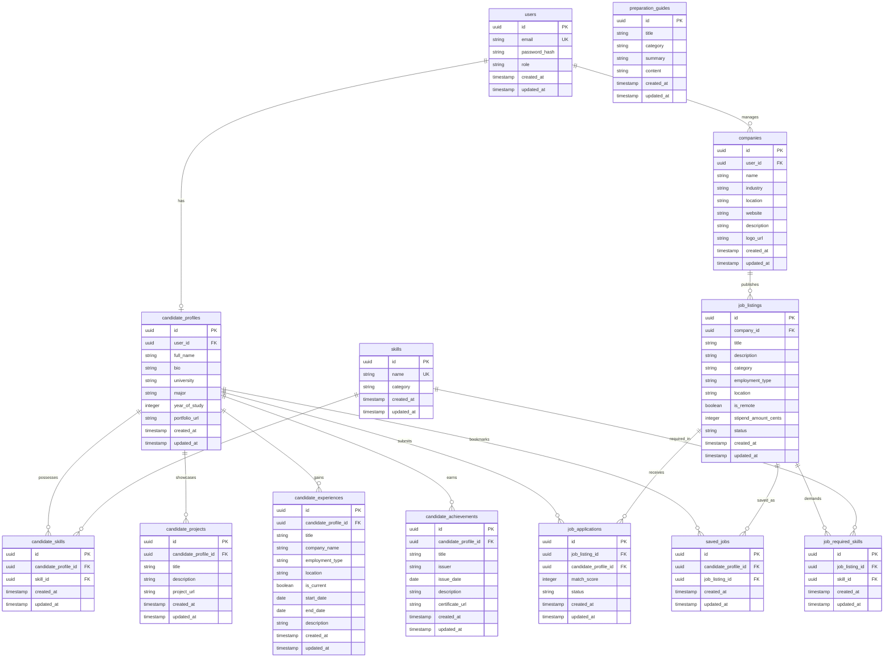

# Phase 3.3 — Database ERD

**Objective:** Design the data model your features need: every table, column, constraint and relationship, decided before any migration is written.

**Status:** Submitted · **Last updated:** 2026-11-03

## Done When

- [x] The ERD covers every Must-Have feature and journey, and renders on GitHub
- [x] Every table has a primary key and created/updated timestamps
- [x] Every foreign key has an on-delete rule in the data dictionary
- [x] No money columns use a floating-point type

---

## 1. Conventions

- **Naming:** Table names are plural and in `snake_case` (e.g. `job_listings`, `candidate_skills`).
- **Keys & Timestamps:** Every table has a primary key `id` (UUIDv4) and timestamps `created_at` and `updated_at` (defaulting to current timestamp).
- **Foreign Keys:** Named `<singular_entity>_id` and indexed for efficient joins.
- **Monetary Values:** Stored as an integer in the smallest currency unit (e.g. `stipend_amount_cents` in USD cents), never as a float.
- **Referential Integrity:** Explicit `ON DELETE CASCADE` or `ON DELETE RESTRICT` rules are defined for every foreign key constraint.

---

## 2. Entity Relationship Diagram

---

## 3. Data Dictionary

### Table: `users`
Stores login credentials and role assignment for all system accounts.

| Column | Data type | Constraints | Nullable | Description |
|---|---|---|---|---|
| `id` | uuid | PRIMARY KEY, DEFAULT gen_random_uuid() | No | Unique identifier for user account |
| `email` | varchar(255) | UNIQUE | No | User's email address used for authentication |
| `password_hash` | varchar(255) | None | No | Salted and hashed password (bcrypt) |
| `role` | varchar(20) | CHECK (role IN ('CANDIDATE', 'EMPLOYER')) | No | User account role for authorization |
| `created_at` | timestamp | DEFAULT now() | No | Account creation timestamp |
| `updated_at` | timestamp | DEFAULT now() | No | Account last modified timestamp |

---

### Table: `candidate_profiles`
Stores candidate information and academic details (1-to-1 with a candidate `users` record).

| Column | Data type | Constraints | Nullable | Description |
|---|---|---|---|---|
| `id` | uuid | PRIMARY KEY, DEFAULT gen_random_uuid() | No | Unique profile identifier |
| `user_id` | uuid | UNIQUE, FK → users(id) ON DELETE CASCADE | No | Associated candidate user account |
| `full_name` | varchar(100) | None | No | Candidate's full name |
| `bio` | text | None | Yes | Short personal summary or career goal |
| `university` | varchar(150) | None | Yes | Enrolled educational institution |
| `major` | varchar(100) | None | Yes | Tech field of study (e.g. Computer Science, Information Technology, Software Engineering) |
| `year_of_study` | integer | CHECK (year_of_study BETWEEN 1 AND 6) | Yes | Current academic year (e.g. 1 to 4) |
| `portfolio_url` | varchar(255) | None | Yes | Link to GitHub, GitLab, or personal developer portfolio |
| `created_at` | timestamp | DEFAULT now() | No | Profile creation timestamp |
| `updated_at` | timestamp | DEFAULT now() | No | Profile last modified timestamp |

---

### Table: `candidate_projects`
Showcases academic and side projects on a candidate's profile (serving F-01).

| Column | Data type | Constraints | Nullable | Description |
|---|---|---|---|---|
| `id` | uuid | PRIMARY KEY, DEFAULT gen_random_uuid() | No | Unique project identifier |
| `candidate_profile_id` | uuid | FK → candidate_profiles(id) ON DELETE CASCADE | No | Parent candidate profile |
| `title` | varchar(150) | None | No | Name of the project |
| `description` | text | None | Yes | Overview of what the project does and tools used |
| `project_url` | varchar(255) | None | Yes | Public link to code repository or live demo |
| `created_at` | timestamp | DEFAULT now() | No | Project creation timestamp |
| `updated_at` | timestamp | DEFAULT now() | No | Project last modified timestamp |

---

### Table: `candidate_experiences`
Stores professional, internship, freelance, or club technical work experience on a candidate profile (serving F-01).

| Column | Data type | Constraints | Nullable | Description |
|---|---|---|---|---|
| `id` | uuid | PRIMARY KEY, DEFAULT gen_random_uuid() | No | Unique experience identifier |
| `candidate_profile_id` | uuid | FK → candidate_profiles(id) ON DELETE CASCADE | No | Associated candidate profile |
| `title` | varchar(150) | None | No | Job title or role (e.g. "Junior Web Developer Intern", "IT Club Lead") |
| `company_name` | varchar(150) | None | No | Employing company or organization name |
| `employment_type` | varchar(50) | CHECK (employment_type IN ('INTERNSHIP', 'PART_TIME', 'FULL_TIME', 'FREELANCE', 'VOLUNTEER')) | Yes | Work arrangement type |
| `location` | varchar(150) | None | Yes | Office city or work location (e.g. "Phnom Penh", "Remote") |
| `is_current` | boolean | DEFAULT false | No | Whether the candidate currently works here |
| `start_date` | date | None | No | Start date of employment |
| `end_date` | date | None | Yes | End date of employment (null if currently working) |
| `description` | text | None | Yes | Key responsibilities, accomplishments, and tech used |
| `created_at` | timestamp | DEFAULT now() | No | Experience record creation timestamp |
| `updated_at` | timestamp | DEFAULT now() | No | Experience record last modified timestamp |

---

### Table: `candidate_achievements`
Tracks certifications, hackathon awards, honors, and technical competition achievements (serving F-01).

| Column | Data type | Constraints | Nullable | Description |
|---|---|---|---|---|
| `id` | uuid | PRIMARY KEY, DEFAULT gen_random_uuid() | No | Unique achievement identifier |
| `candidate_profile_id` | uuid | FK → candidate_profiles(id) ON DELETE CASCADE | No | Associated candidate profile |
| `title` | varchar(150) | None | No | Title of award or certification (e.g. "1st Place - University Hackathon") |
| `issuer` | varchar(150) | None | No | Issuing organization or platform (e.g. "AWS", "Google", "CADT") |
| `issue_date` | date | None | Yes | Date awarded or certified |
| `description` | text | None | Yes | Brief description of the achievement or scope |
| `certificate_url` | varchar(255) | None | Yes | Public verification URL, badge link, or proof |
| `created_at` | timestamp | DEFAULT now() | No | Achievement record creation timestamp |
| `updated_at` | timestamp | DEFAULT now() | No | Achievement record last modified timestamp |

---

### Table: `skills`
Master catalog of standardized technical skills used for matching.

| Column | Data type | Constraints | Nullable | Description |
|---|---|---|---|---|
| `id` | uuid | PRIMARY KEY, DEFAULT gen_random_uuid() | No | Unique skill identifier |
| `name` | varchar(100) | UNIQUE | No | Standard skill name (e.g. "Flutter", "TypeScript") |
| `category` | varchar(50) | None | No | Technical skill classification (e.g. "Frontend", "Backend", "Mobile", "DevOps", "Database", "QA") |
| `created_at` | timestamp | DEFAULT now() | No | Skill entry creation timestamp |
| `updated_at` | timestamp | DEFAULT now() | No | Skill entry last modified timestamp |

---

### Table: `candidate_skills`
Associates skills possessed by a candidate with their profile.

| Column | Data type | Constraints | Nullable | Description |
|---|---|---|---|---|
| `id` | uuid | PRIMARY KEY, DEFAULT gen_random_uuid() | No | Unique association identifier |
| `candidate_profile_id` | uuid | FK → candidate_profiles(id) ON DELETE CASCADE | No | Associated candidate profile |
| `skill_id` | uuid | FK → skills(id) ON DELETE RESTRICT | No | Associated technical skill |
| `created_at` | timestamp | DEFAULT now() | No | Association timestamp |
| `updated_at` | timestamp | DEFAULT now() | No | Association last modified timestamp |

*Table Constraint:* `UNIQUE (candidate_profile_id, skill_id)` prevents assigning duplicate skills to the same candidate profile.

---

### Table: `companies`
Stores employer organization profiles and recruitment details.

| Column | Data type | Constraints | Nullable | Description |
|---|---|---|---|---|
| `id` | uuid | PRIMARY KEY, DEFAULT gen_random_uuid() | No | Unique company identifier |
| `user_id` | uuid | FK → users(id) ON DELETE CASCADE | No | Employer user account that manages this company |
| `name` | varchar(150) | None | No | Official company or startup name |
| `industry` | varchar(100) | None | Yes | Business sector (e.g. "Fintech", "E-commerce") |
| `location` | varchar(150) | None | Yes | Office address or city (e.g. "Phnom Penh") |
| `website` | varchar(255) | None | Yes | Official company website URL |
| `description` | text | None | Yes | Brief description of company culture and work |
| `logo_url` | varchar(255) | None | Yes | URL path to company logo image |
| `created_at` | timestamp | DEFAULT now() | No | Company profile creation timestamp |
| `updated_at` | timestamp | DEFAULT now() | No | Company profile last modified timestamp |

---

### Table: `job_listings`
Stores entry-level jobs and internships posted by employers (serving F-02 and F-09).

| Column | Data type | Constraints | Nullable | Description |
|---|---|---|---|---|
| `id` | uuid | PRIMARY KEY, DEFAULT gen_random_uuid() | No | Unique job listing identifier |
| `company_id` | uuid | FK → companies(id) ON DELETE CASCADE | No | Publishing company |
| `title` | varchar(150) | None | No | Job position title (e.g. "Junior Backend Developer") |
| `description` | text | None | No | Full role overview, responsibilities, and perks |
| `category` | varchar(100) | None | No | Tech role specialization (e.g. "Software Engineering", "Mobile Development", "Frontend", "Backend", "DevOps & Cloud", "QA & Testing", "Data & AI", "Network & IT Support") |
| `employment_type` | varchar(50) | CHECK (employment_type IN ('INTERNSHIP', 'ENTRY_LEVEL', 'PART_TIME', 'FULL_TIME')) | No | Work arrangement |
| `location` | varchar(150) | None | No | Work location |
| `is_remote` | boolean | DEFAULT false | No | Indicates if remote work is permitted |
| `stipend_amount_cents` | integer | CHECK (stipend_amount_cents >= 0) | Yes | Monthly stipend/salary in USD cents (e.g. 25000 = $250.00); integer type prevents rounding issues |
| `status` | varchar(20) | CHECK (status IN ('OPEN', 'CLOSED')) | No | Whether the opening is actively accepting applications |
| `created_at` | timestamp | DEFAULT now() | No | Job post creation timestamp |
| `updated_at` | timestamp | DEFAULT now() | No | Job post last modified timestamp |

---

### Table: `job_required_skills`
Defines the explicit technical skills required for a job listing (used by F-03 to evaluate skill gaps).

| Column | Data type | Constraints | Nullable | Description |
|---|---|---|---|---|
| `id` | uuid | PRIMARY KEY, DEFAULT gen_random_uuid() | No | Unique requirement identifier |
| `job_listing_id` | uuid | FK → job_listings(id) ON DELETE CASCADE | No | Target job listing |
| `skill_id` | uuid | FK → skills(id) ON DELETE RESTRICT | No | Required technical skill |
| `created_at` | timestamp | DEFAULT now() | No | Requirement creation timestamp |
| `updated_at` | timestamp | DEFAULT now() | No | Requirement last modified timestamp |

*Table Constraint:* `UNIQUE (job_listing_id, skill_id)` ensures a skill is not required twice on the same job.

---

### Table: `job_applications`
Tracks candidate applications to job openings, including the computed skill fit score (serving F-06 and UJ-07).

| Column | Data type | Constraints | Nullable | Description |
|---|---|---|---|---|
| `id` | uuid | PRIMARY KEY, DEFAULT gen_random_uuid() | No | Unique application identifier |
| `job_listing_id` | uuid | FK → job_listings(id) ON DELETE CASCADE | No | Job opening applied to |
| `candidate_profile_id` | uuid | FK → candidate_profiles(id) ON DELETE CASCADE | No | Applying candidate profile |
| `match_score` | integer | CHECK (match_score BETWEEN 0 AND 100) | No | Percentage of required skills the candidate possessed at the time of applying |
| `status` | varchar(20) | CHECK (status IN ('SUBMITTED', 'UNDER_REVIEW', 'ACCEPTED', 'REJECTED')) | No | Recruiter review status |
| `created_at` | timestamp | DEFAULT now() | No | Application submission timestamp |
| `updated_at` | timestamp | DEFAULT now() | No | Application status last modified timestamp |

*Table Constraint:* `UNIQUE (job_listing_id, candidate_profile_id)` guarantees a candidate can only apply to a job once.

---

### Table: `saved_jobs`
Stores bookmarked job listings for candidate quick access (serving UJ-04).

| Column | Data type | Constraints | Nullable | Description |
|---|---|---|---|---|
| `id` | uuid | PRIMARY KEY, DEFAULT gen_random_uuid() | No | Unique bookmark identifier |
| `candidate_profile_id` | uuid | FK → candidate_profiles(id) ON DELETE CASCADE | No | Candidate who saved the job |
| `job_listing_id` | uuid | FK → job_listings(id) ON DELETE CASCADE | No | Saved job listing |
| `created_at` | timestamp | DEFAULT now() | No | Bookmark timestamp |
| `updated_at` | timestamp | DEFAULT now() | No | Bookmark last modified timestamp |

*Table Constraint:* `UNIQUE (candidate_profile_id, job_listing_id)` prevents saving the same job multiple times.

---

### Table: `preparation_guides`
Stores curated study guides, project ideas, and interview preparation content for candidates (serving F-04 and UJ-05).

| Column | Data type | Constraints | Nullable | Description |
|---|---|---|---|---|
| `id` | uuid | PRIMARY KEY, DEFAULT gen_random_uuid() | No | Unique guide identifier |
| `title` | varchar(150) | None | No | Guide title (e.g. "How to Structure an IT Portfolio") |
| `category` | varchar(100) | None | No | Guide section (e.g. "Portfolio Guides", "Interview Tips") |
| `summary` | varchar(255) | None | No | Short preview summary displayed in guide lists |
| `content` | text | None | No | Full markdown guide content |
| `created_at` | timestamp | DEFAULT now() | No | Guide creation timestamp |
| `updated_at` | timestamp | DEFAULT now() | No | Guide last modified timestamp |
