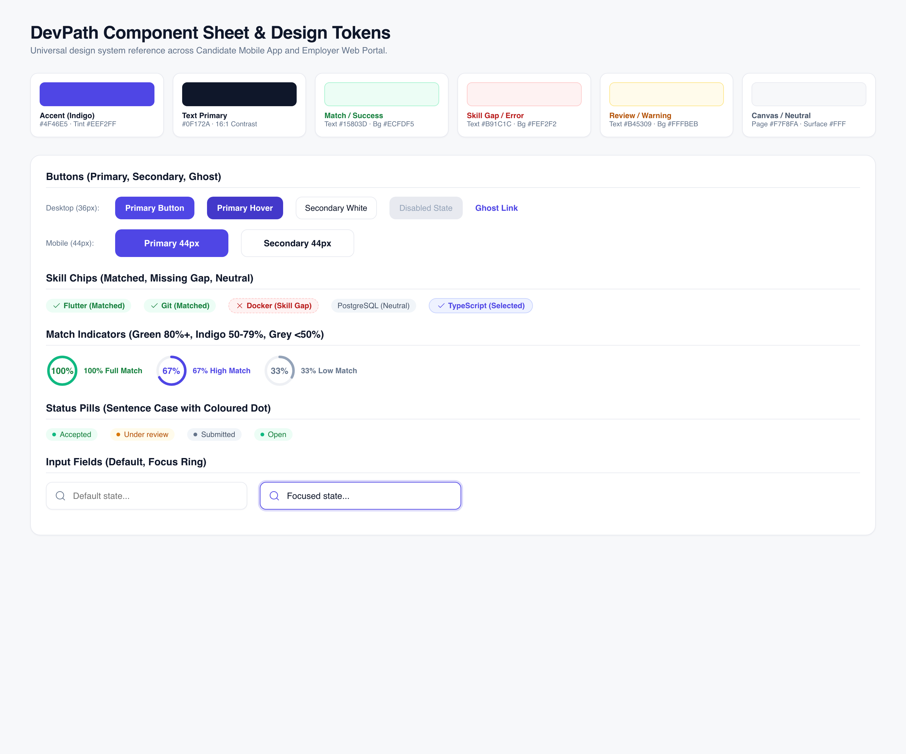
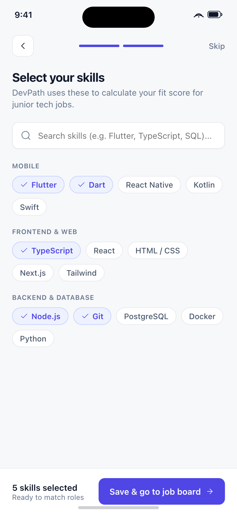
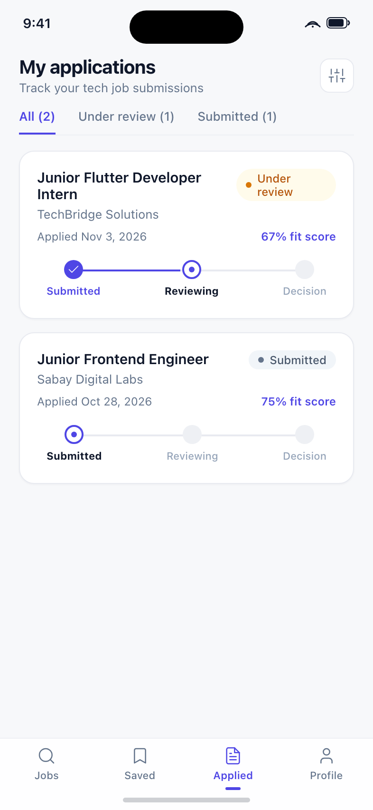

# Phase 4.1 — Figma Specifications

**Objective:** Design every screen before you build it: a cohesive design system, candidate mobile & employer desktop screens, and a clickable prototype of core journeys.

**Status:** Submitted · **Last updated:** 2026-11-17

| Item | Value |
|---|---|
| Figma view-only project URL | https://www.figma.com/design/otuXkH2lhb0nVRzsNo5uY7?node-id=10-2 |
| Figma interactive prototype URL | https://www.figma.com/proto/otuXkH2lhb0nVRzsNo5uY7?node-id=10-2&scaling=scale-down |
| Target frame resolution | Mobile 393×852 (iPhone 15) & Web 1440×900 (Desktop Web Portal) |

Both links are set to "Anyone with the link can view" and verified accessible.

## Done When

- [x] Both Figma links open in a private browser window
- [x] The Figma file has a style guide, component inventory, and all screens
- [x] Every screen has an ID (SCR-01, SCR-02, …) and a Figma frame with the same name
- [x] Every journey step from Phase 2.2 has a screen
- [x] 6–10 key screens are exported as PNG into `context/assets/figma/` and display in this file on GitHub

---

## 1. Your Figma File Structure

The DevPath Figma design file (`otuXkH2lhb0nVRzsNo5uY7`) is organized into dedicated visual artboards adhering to the **Calm & Airy** design principles (Linear / Vercel aesthetic):

1. **Section 01 · Reusable Component Sheet & Token Library:**
   - Centralized color tokens with strict WCAG AA contrast ratings (≥ 4.5:1).
   - Interactive components in all states (default, hover, focus, disabled, selected): primary/secondary/ghost buttons (44px touch targets on mobile, 36px on desktop), skill chips (matched, missing gap, neutral), circular SVG match indicators, sentence-case status pills with colored dots, and input fields with 3px 20% opacity indigo focus rings.
2. **Section 02 · Candidate Mobile App (Flutter — 393 × 852 px):**
   - High-fidelity mobile frames (`SCR-01`, `SCR-02`, `SCR-03`, `SCR-04`, `SCR-06`, `SCR-08`) covering candidate onboarding, skill selection, beginner job board, automated skill gap analyzer, applications tracker, and profile.
3. **Section 03 · Employer Web Portal (Next.js — 1440 × 900 px):**
   - Desktop frames (`SCR-10`, `SCR-12`) for recruitment KPIs, active postings table, and applicant evaluation ranked by match percentage.
4. **Interactive Prototypes:**
   - Clickable prototype flows connecting the core user journeys (`UJ-01` through `UJ-08`), including skill selection, automated skill gap analysis, job application, and applicant evaluation.

---

## 2. Design System Tokens

### Design Principles
1. **Calm and airy:** Generous whitespace, one primary accent colour (`#4F46E5`), no visual noise or clutter.
2. **Skill match is the hero:** Match percentage rings and matched vs. missing skills are the most prominent and legible elements on every screen where they appear.
3. **Consistency:** Shared components look identical on mobile and desktop, scaled only for platform density (44px touch height mobile vs. 36px desktop).
4. **Accessible:** Strict WCAG AA contrast (≥ 4.5:1 for all text), 44px minimum touch targets on mobile, keyboard focus rings.
5. **No emojis or text glyphs:** Clean 1.5px stroke Lucide line icons used exclusively throughout the interface.

### Color Tokens

Text complies with WCAG AA contrast (≥ 4.5:1 against its background). Semantic states are applied strictly as soft tints with dark text, never as harsh solid fills.

| Token | Hex | Used for | Contrast Ratio |
|---|---|---|---|
| **Canvas Background** | `#F7F8FA` | Base page canvas, app screen background | Base canvas |
| **Surface** | `#FFFFFF` | Card backgrounds, modals, input fields, navigation bars | Base surface |
| **Border** | `#E8EAF0` | Structural card outlines, input default borders, dividers | Structural outline |
| **Divider** | `#EEF0F4` | Hairline section and table row dividers | Structural divider |
| **Text Primary** | `#0F172A` | Page titles, headings, high-emphasis text, primary icons | 16.1:1 on `#FFFFFF` |
| **Text Secondary** | `#475569` | Body descriptions, company names, secondary meta | 7.3:1 on `#FFFFFF` |
| **Text Muted** | `#64748B` | Form labels, timestamps, applicant counts, placeholders | 4.8:1 on `#FFFFFF` |
| **Accent (Indigo)** | `#4F46E5` | Primary CTA buttons, active tab indicators, links, active rings | 5.8:1 on `#FFFFFF` |
| **Accent Hover** | `#4338CA` | Hover/pressed state for primary actions | 7.1:1 on `#FFFFFF` |
| **Accent Tint** | `#EEF2FF` | Selected skill chips, active category filters, callout backgrounds | Accent background |
| **Semantic Match (Success)** | `#15803D` (text) / `#ECFDF5` (bg) | Matched skills, high fit scores (≥80%), accepted status pill | 5.2:1 against `#ECFDF5` |
| **Semantic Skill Gap (Error)** | `#B91C1C` (text) / `#FEF2F2` (bg) | Missing skill gaps, input error validation, rejected status pill | 5.8:1 against `#FEF2F2` |
| **Semantic Review (Warning)** | `#B45309` (text) / `#FFFBEB` (bg) | Under-review status pill, moderate fit scores (50–79%) | 5.1:1 against `#FFFBEB` |
| **Semantic Neutral / Submitted** | `#475569` (text) / `#F1F5F9` (bg) | Submitted status pill, neutral skill chips, meta tags | 6.2:1 against `#F1F5F9` |

### Typography Scale

Typography uses `Inter` for Latin text with `Noto Sans Khmer` as the fallback to ensure Cambodian names and Khmer scripts render cleanly.

| Use | Font, Size & Weight | Line Height | Tracking |
|---|---|---|---|
| **Page Title (H1)** | Inter / Noto Sans Khmer 28 px SemiBold (`600`) | 34 px | -0.02em |
| **Section Title (H2)** | Inter / Noto Sans Khmer 20 px SemiBold (`600`) | 26 px | -0.01em |
| **Card Title (H3)** | Inter / Noto Sans Khmer 16 px SemiBold (`600`) | 22 px | 0em |
| **Body Text** | Inter / Noto Sans Khmer 14 px Regular (`400`) / Medium (`500`) | 20 px | 0em |
| **Meta / Captions** | Inter / Noto Sans Khmer 12 px Medium (`500`) | 16 px | +0.01em |
| **Labels & Badges** | Inter / Noto Sans Khmer 11 px SemiBold (`600`) | 14 px | +0.02em |

### Spacing & Elevation
- **Spacing Grid:** 8px base grid (`8px`, `16px`, `24px`, `32px`, `40px`, `48px`).
- **Corner Radii:** `10px` for controls (buttons, inputs), `16px` for cards, `999px` for pill chips and avatars.
- **Elevation / Shadow:** One level only: `0 1px 2px rgba(16, 24, 40, 0.04)`. A slightly deeper shadow `0 4px 6px -1px rgba(16, 24, 40, 0.06)` on hover or active selection.

### Component Inventory

| Component | Specifications & Variants | States Covered | Done |
|---|---|---|---|
| **Primary Button** | Indigo (`#4F46E5`), white text, 10px radius, 44px mobile / 36px desktop | Default, hover (`#4338CA`), focus ring, disabled (`#94A3B8`) | Yes |
| **Secondary Button** | White surface, 1px border (`#E8EAF0`), dark text (`#0F172A`) | Default, hover (`#F8FAFC`), pressed, disabled | Yes |
| **Ghost Button** | Transparent background, text only (`#4F46E5` or `#64748B`) | Default, hover, pressed | Yes |
| **Skill Chip** | Matched (green tint `#ECFDF5` + check), Missing (dashed outline `#E8EAF0`, text `#B91C1C` + x), Neutral (`#F1F5F9`) | Default, selected, disabled | Yes |
| **Match Ring** | Thin circular SVG ring or bar with bold % text (≥80% green, 50–79% indigo, &lt;50% grey) | High fit (92%), Medium fit (67%), Low fit (33%) | Yes |
| **Status Pill** | Sentence-case label with coloured dot (`Accepted`, `Under review`, `Submitted`, `Open`) | Accepted (green), Under review (amber), Submitted (slate), Open (indigo) | Yes |
| **Text Input** | 46px tall, 10px radius, 1px border (`#E8EAF0`), 1.5px stroke Lucide icon on left | Default, focus (3px 20% opacity indigo ring), error, disabled | Yes |
| **Cards** | Surface white (`#FFFFFF`), 16px radius, 1px border (`#E8EAF0`), 20px padding, single shadow | Default, hover/selected | Yes |
| **Bottom Tab Bar (Mobile)** | 4 items: Jobs, Saved, Applied, Profile. Active indigo pill indicator, blurred surface, safe area | Default, active | Yes |
| **Top Navigation (Desktop)** | DevPath logo, 4 navigation links with subtle indigo underline on active link, avatar menu | Default, active | Yes |

---

## 3. Screen-by-Screen Catalog

The DevPath application encompasses 12 dedicated screens spanning both the Candidate Mobile App and Employer Web Portal, covering all 8 user journeys (`UJ-01` to `UJ-08`) and all 23 API endpoints (`EP-01` to `EP-23`).

| Screen ID | Screen name | Purpose | Figma frame | User journey | Endpoint |
|---|---|---|---|---|---|
| **SCR-01** | Candidate Login & Welcome | Authenticate candidate via email/password or GitHub SSO; sliding segmented control for candidate vs recruiter. | `SCR-01 / Candidate Login & Welcome` | UJ-01 | EP-03, EP-04 |
| **SCR-02** | Candidate Registration & Skills | Account onboarding with 2-segment progress bar, categorized skill chips, and sticky bottom selection bar. | `SCR-02 / Candidate Registration & Skills` | UJ-01 | EP-02, EP-05, EP-08 |
| **SCR-03** | Candidate Job Board & Search | Curated list of entry-level tech roles with integrated search filter, circular match rings, and matched/missing chip previews. | `SCR-03 / Curated IT Job Board` | UJ-02 | EP-10 |
| **SCR-04** | Job Details & Skill Fit Analyzer | Core signature screen: focal skill-gap card with large match ring, separated matched and missing skills, soft indigo tip callout, and sticky apply bar. | `SCR-04 / Job Details & Skill Fit Analyzer` | UJ-03, UJ-04, UJ-07 | EP-11, EP-12, EP-14, EP-16 |
| **SCR-05** | Saved Jobs | Candidate bookmarked job listings saved for later review with quick removal and apply shortcuts. | `SCR-05 / Saved Jobs` | UJ-04 | EP-13, EP-15 |
| **SCR-06** | Candidate Applications Tracker | Underline tabs with count pills, 3-step horizontal stepper (Submitted → Reviewing → Decision) with active rings and check states. | `SCR-06 / Candidate Applications Tracker` | UJ-07 | EP-17 |
| **SCR-07** | Preparation Hub & Guides | Curated portfolio structuring guides, junior technical interview tips, and learning roadmaps to close identified skill gaps. | `SCR-07 / Preparation Hub & Guides` | UJ-05 | EP-23 |
| **SCR-08** | Candidate Profile & Tech Portfolio | Profile card with avatar, GitHub/portfolio link pills, clean section cards with ghost "+ Add" buttons, and trophy icon achievement tile. | `SCR-08 / Candidate Profile & Portfolio` | UJ-01 | EP-06, EP-07, EP-08, EP-09 |
| **SCR-09** | Employer Login & Company Setup | Web portal authentication for tech recruiters and company profile onboarding (name, industry, location, website). | `SCR-09 / Employer Login & Company Setup` | UJ-06 | EP-03, EP-18 |
| **SCR-10** | Employer Recruitment Dashboard | Desktop dashboard with 4 KPI cards with trend deltas, top-right "Post a new IT job" CTA, and borderless table with hairline dividers. | `SCR-10 / Recruitment Dashboard` | UJ-06 | EP-19 |
| **SCR-11** | Employer Post a New IT Job | Web portal job publishing form to specify entry-level roles, stipend, descriptions, and required technical skill tags. | `SCR-11 / Employer Post a Job` | UJ-06 | EP-05, EP-20 |
| **SCR-12** | Employer Review Applicants | Desktop applicant evaluation view ranking candidate submissions by technical skill match score, displaying skill gaps, and updating hiring status. | `SCR-12 / Review Applicants` | UJ-08 | EP-21, EP-22 |

---

## 4. Offline Asset Archive

Exported high-fidelity 2x resolution PNG screens saved in `context/assets/figma/` representing key touchpoints across both client platforms:

### Reusable Component Sheet & Token Library
Standard token swatches, button states, skill chips, circular match rings, status pills, and focus inputs.

### SCR-01 — Candidate Login & Welcome
Centred indigo tile logo, sliding segmented control, email and password inputs with left Lucide icons, and GitHub secondary button.

### SCR-02 — Candidate Registration & Skills Selection
2-segment progress bar, search input, categorized technical skill chips (Mobile, Frontend, Backend), and sticky bottom selection bar.

### SCR-03 — Curated Beginner IT Job Board
Header with notification bell dot, integrated search filter icon, job cards with circular SVG match rings, neutral meta chips, and matched/gap chips.

### SCR-04 — Job Details & Skill Fit Analyzer
Signature screen: prominent skill-gap card with large 67% circular match ring, separated matching and missing groups, soft indigo lightbulb tip callout, and sticky apply bar.

### SCR-06 — Candidate Applications Tracker
Underline tabs with counts, application card with 3-step horizontal stepper (completed indigo check, current ring, future grey).

### SCR-08 — Candidate Profile & Technical Portfolio
Profile header card with avatar, academic year, GitHub and website link pills, clean section cards with ghost "+ Add" buttons, and trophy achievement tile.

### SCR-10 — Employer Web Portal: Recruitment Dashboard
Four KPI cards with delta trends, primary "Post a new IT job" CTA, borderless table with sticky header, hairline dividers, neutral skill chips, and status pills.

### SCR-12 — Employer Web Portal: Review Applicants (Visual Reference Anchor)
Evaluation table ranking candidates by skill match percentage with circular match rings, candidate status pills, matching and dashed gap chips, and status dropdown.

