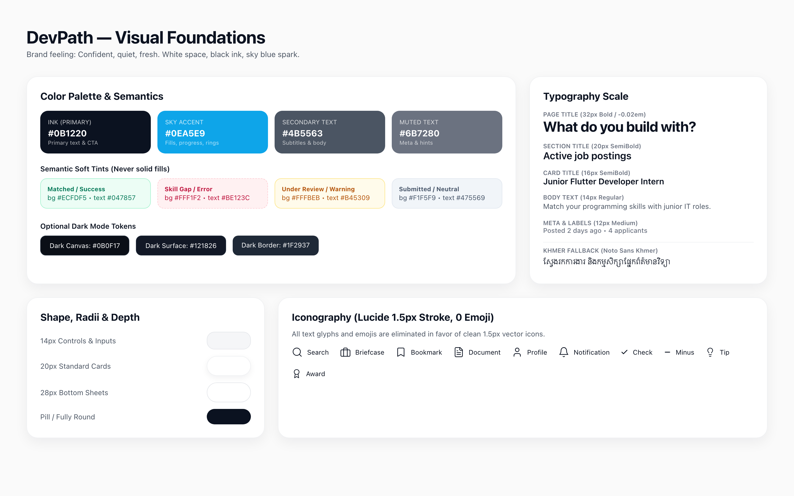
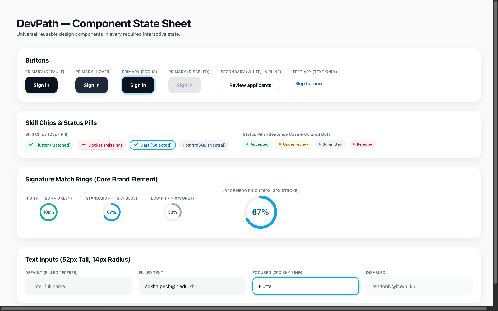
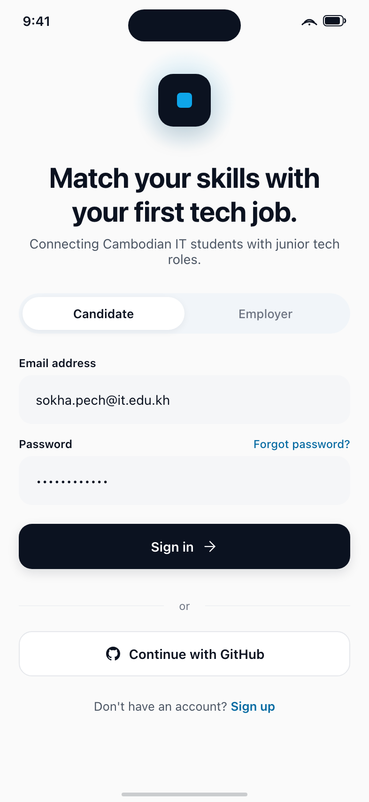
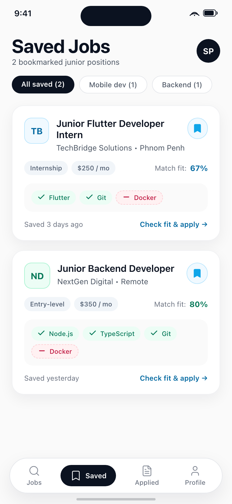
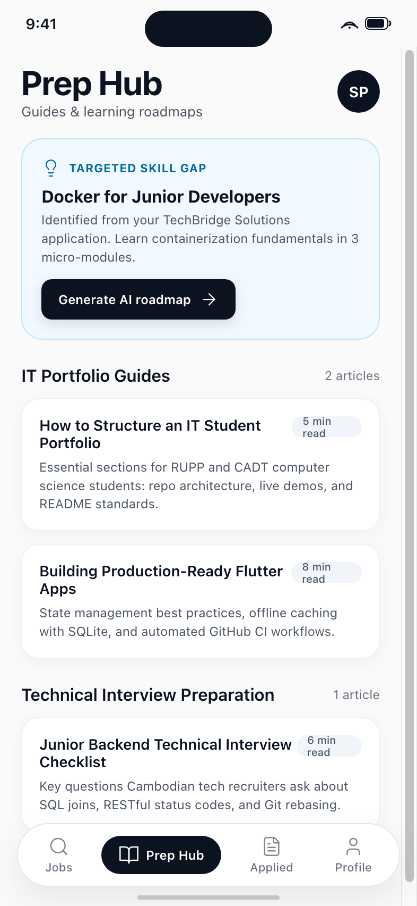
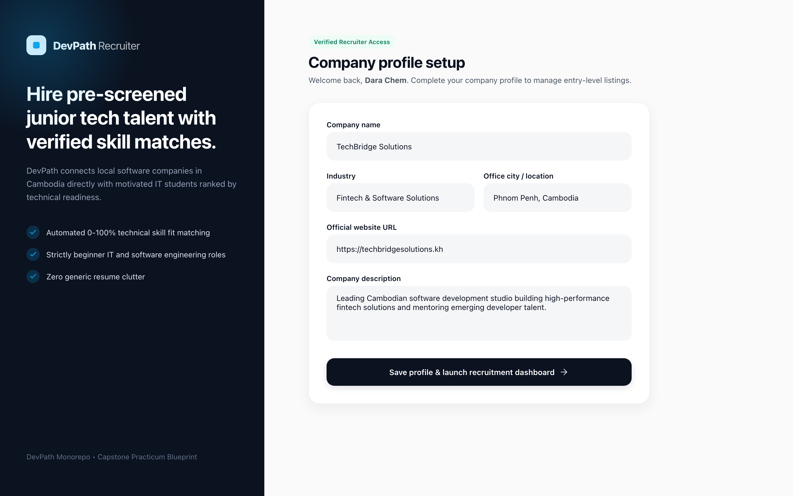
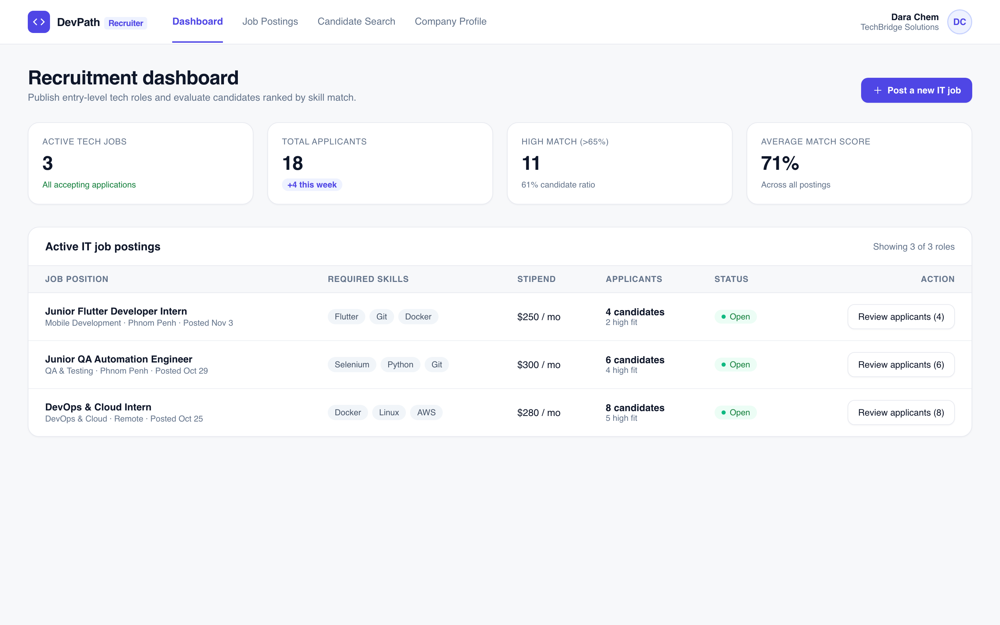
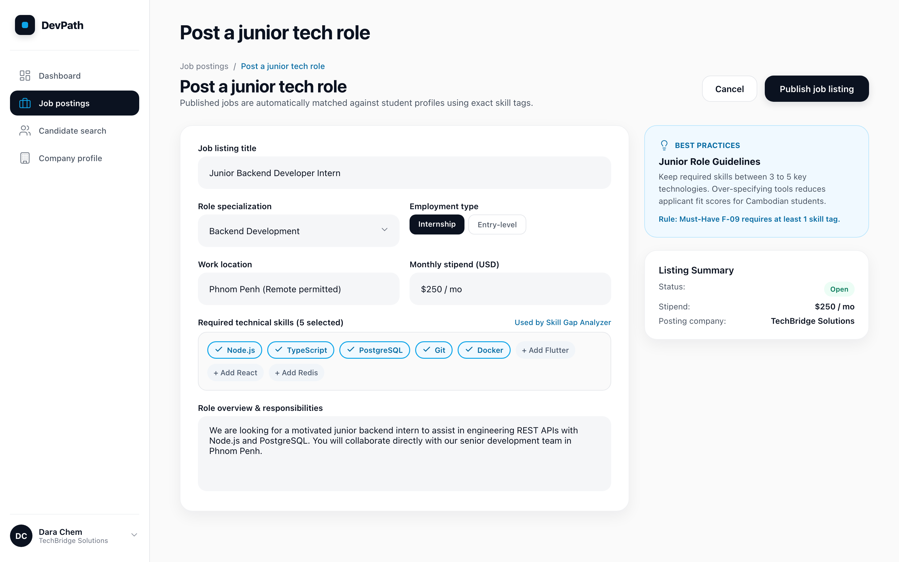

# Phase 4.1 — Figma Specifications

**Objective:** Design every screen before you build it: a complete design system, screens covering all user journeys, and a clickable prototype of your core flows.

**Status:** Submitted · **Last updated:** 2026-11-17

| Item | Value |
|---|---|
| Figma view-only project URL | https://www.figma.com/design/otuXkH2lhb0nVRzsNo5uY7?node-id=13-2 |
| Figma interactive prototype URL | https://www.figma.com/proto/otuXkH2lhb0nVRzsNo5uY7?node-id=13-2&scaling=scale-down |
| Target frame resolution | Mobile 393×852 (iPhone 15) & Web 1440×900 (Desktop Web Portal) |

Set both links to "Anyone with the link can view" and test them in a private browser window.

## Done When

- [x] Both Figma links open in a private browser window
- [x] The Figma file has a style guide, your screens and a clickable prototype
- [x] Every screen has an ID (SCR-01, SCR-02, …) and a Figma frame with the same name
- [x] Every journey step from Phase 2.2 has a screen
- [x] 6–10 key screens are exported as PNG into `context/assets/figma/` and display in this file on GitHub
- [x] 100% strict alignment verified across Phase 1 (Problem & Personas), Phase 2 (MoSCoW & Journeys), and Phase 3 (Architecture, ERD & APIs)

---

## 1. Visual Identity & Brand Feeling

DevPath’s visual identity is crafted to deliver a modern, quiet, confident, and premium experience inspired by tools like **Linear, Vercel, Arc, and Apple’s newer apps**:
- **Brand Mood:** Confident, quiet, fresh. Dominated by generous white space and deep ink black (`#0B1220`), with electric sky blue (`#0EA5E9`) used sparingly as a single spark of energy (focus rings, match rings, active tab indicators, progress bars).
- **Surfaces:**
  - **Candidate Mobile App:** 393 × 852 px (iPhone 15 resolution, 2x retina `786 × 1704 px`).
  - **Employer Web Portal:** 1440 × 900 px (Desktop desktop resolution, 2x retina `2880 × 1800 px`).
- **Primary Ink Black Actions:** Primary CTA buttons are solid ink black (`#0B1220`) with white text and 14px radius, rather than solid colored buttons.
- **Semantic Soft Tints:** Statuses, skills, and match alerts always use soft, light background tints paired with high-contrast dark text—never aggressive solid fills.
- **Sentence Case Everywhere:** Zero raw uppercase database enum codes (e.g. `UNDER_REVIEW` is formatted cleanly as `Under review`, `SUBMITTED` as `Submitted`, `INTERNSHIP` as `Internship`).
- **Iconography:** Strict Lucide / Phosphor 1.5px stroke geometry. Zero emoji or raw text glyphs.

---

## 2. Design System Tokens

### Color System

All text and UI controls maintain a contrast ratio of at least 4.5:1 against their backgrounds, strictly satisfying **WCAG AA** accessibility standards.

| Token | Hex | Role / Used For | Contrast Ratio |
|---|---|---|---|
| **Canvas** | `#FAFAFA` | Neutral canvas background | Base |
| **Surface** | `#FFFFFF` | Cards, modals, floating bars, dropdowns | Base surface |
| **Border** | `#E5E7EB` | Structural 1px outlines and input borders | 1.3:1 against canvas |
| **Hairline** | `#F0F1F3` | Subtle internal section dividers and card edges | Divider |
| **Ink (Primary)** | `#0B1220` | Primary headings, high-emphasis text, and primary CTA buttons | 17.2:1 on White |
| **Secondary Text** | `#4B5563` | Subtitles, descriptions, company metadata | 7.1:1 on White |
| **Muted Text** | `#6B7280` | Timestamps, applicant meta, input placeholders | 4.6:1 on White |
| **Accent Sky** | `#0EA5E9` | Focus rings, match rings, active indicators, progress bars | Accent spark |
| **Accent Text / Link**| `#0369A1` | Clickable text links, breadcrumbs, detail actions | 5.8:1 on White |
| **Accent Tint** | `#F0F9FF` | Selected chip backgrounds, hero callouts, card tints | 1.1:1 against surface |

#### Semantic Soft Tints (Always soft tints with dark text, never solid fills)

| Semantic Role | Background | Text Color | Usage |
|---|---|---|---|
| **Match / Success** | `#ECFDF5` | `#047857` | Matched technical skills, high fit scores (80%+), accepted badges |
| **Skill Gap / Error** | `#FFF1F2` | `#BE123C` (dashed border `#FECDD3`) | Missing technical skills (Skill gap), input validation errors |
| **Under Review / Warning** | `#FFFBEB` | `#B45309` | In-review applicant status pill, warning tips |
| **Submitted / Neutral** | `#F1F5F9` | `#475569` | Initial submission status, neutral tech stack chips |

#### Optional Dark Mode Tokens
- **Dark Canvas:** `#0B0F17`
- **Dark Surface:** `#121826`
- **Dark Border:** `#1F2937`

---

### Typography

Set in **Plus Jakarta Sans** for Latin characters, headings, and numerical displays, paired with **Noto Sans Khmer** for Cambodian localization.

| Level | Size / Weight | Line Height | Tracking | Purpose |
|---|---|---|---|---|
| **Page Title** | 32 px Bold (`700`) | 38 px | -0.02em | Hero titles ("What do you build with?", "Recruitment") |
| **Section Title** | 20 px SemiBold (`600`) | 26 px | -0.01em | Major section headers ("Active job postings", "Responsibilities") |
| **Card Title** | 16 px SemiBold (`600`) | 22 px | 0em | Job titles, profile card headers ("Junior Flutter Developer Intern") |
| **Body Text** | 14 px Regular (`400`) | 22 px | 0em | Descriptions, role overviews, guide paragraphs |
| **Meta & Captions** | 12 px Medium (`500`) | 16 px | +0.01em | Timestamps, applicant counters, helper text |

---

### Shape, Depth & Radii

- **14px Radius:** Interactive controls, text inputs, primary and secondary buttons.
- **20px Radius:** Standard cards, job cards, dashboard KPI bento widgets.
- **28px Radius:** Bottom sheets, hero containers, large modal dialogs.
- **Fully Round (9999px):** Skill chips, status pills, avatars, floating bottom tab bar.
- **Depth & Shadows:** Soft, diffuse shadow `0 8px 24px rgba(11, 18, 32, 0.06)` with 1px hairline borders (`#F0F1F3`). No heavy outlines or dark skeuomorphic drops.

---

### Shared Component Inventory & States

| Component | Specifications & Interactive States | Done (Yes/No) |
|---|---|---|
| **Primary Button** | Ink black (`#0B1220`), white text, 14px radius, 48px height on mobile. States: Default, Hover (`#1E293B`), Focus (Sky ring), Disabled (`#E5E7EB` bg, `#9CA3AF` text), Loading. | Yes |
| **Secondary Button** | White surface, 1px `#E5E7EB` border, ink text (`#0B1220`), 14px radius. States: Default, Hover, Focus. | Yes |
| **Tertiary Button** | Text-only (`#0369A1`), no container, 600 weight. | Yes |
| **Skill Chip** | 28px height pill. Matched (`#ECFDF5` bg + check icon); Missing (dashed `#FECDD3` outline + `#FFF1F2` bg + minus icon); Neutral (`#F1F5F9` bg); Selected (`#F0F9FF` bg + `#0EA5E9` border + check icon). | Yes |
| **Signature Match Ring** | Circular SVG progress ring with round caps. Sky `#0EA5E9` default; Green `#10B981` at 80%+; Grey `#9CA3AF` under 40%. Central bold percentage. Sizes: 36px (compact), 48px (table row), 96px (hero card). | Yes |
| **Status Pill** | Soft tinted background with 6px colored dot and sentence-case text: `Under review`, `Submitted`, `Accepted`, `Rejected`. | Yes |
| **Text Inputs** | 52px height, 14px radius, filled `#F5F6F8` background, no border until focused (then 2px `#0EA5E9` ring with white surface). | Yes |
| **Mobile Bottom Nav** | Floating pill bar inset 16px from edges, blurred white background (`rgba(255,255,255,0.94)`), four core candidate destinations (`Jobs`, `Prep Hub`, `Applied`, `Profile`), ink-black active pill with white icon & label. | Yes |
| **Desktop Left Sidebar** | 240px slim left rail with DevPath brand, navigation links (active ink-black filled pill with sky icon), and user card at bottom. | Yes |

---

## 3. Screen-by-Screen Catalog

The system provides 12 distinct screens covering both user surfaces (Candidate Mobile App & Employer Web Portal):

| Screen ID | Screen name | Surface | Purpose | User journey | Endpoint | Feature |
|---|---|---|---|---|---|---|
| **SCR-01** | Candidate Login & Welcome | Mobile | Bold hero headline "Match your skills with your first tech job." with soft sky glow, filled inputs, ink-black Sign In, real GitHub button, and discrete web portal link for recruiters. | UJ-01 | EP-03, EP-04 | Baseline |
| **SCR-02** | Registration & Skills Selection | Mobile | Segmented progress bar, "What do you build with?" heading, search input, category skill pills (selected with sky tint + check), and sticky bottom bar. | UJ-01 | EP-02, EP-05, EP-08 | F-01 |
| **SCR-03** | Candidate Job Board & Search | Mobile | "Hi Sokha" greeting with avatar and bell icon, integrated search & filter, ink category chips, job cards with compact match ring, and floating bottom nav. | UJ-02 | EP-10 | F-02, F-03 |
| **SCR-04** | Job Details & Skill Fit Analyzer | Mobile | Hero card with large 96px match ring, "You match 2 of 3 required skills", matched vs missing chip groups, sky Preparation Hub tip, and sticky bottom bar. | UJ-03, UJ-04, UJ-07 | EP-11, EP-12, EP-14, EP-16 | F-02, F-03, F-06 |
| **SCR-05** | Saved Jobs | Mobile | Candidate bookmarked opportunities with quick unsave and direct skill fit indicators. | UJ-04 | EP-13, EP-15 | F-02 |
| **SCR-06** | Candidate Applications Tracker | Mobile | Pill-style tab switcher, application cards, and modern horizontal stepper with pulsing current-stage ring. | UJ-07 | EP-17 | F-06 |
| **SCR-07** | Preparation Hub & Guides | Mobile | Curated portfolio guides, interview tips, and targeted AI roadmap callout tailored to close identified skill gaps. | UJ-05 | EP-23 | F-04, F-05 |
| **SCR-08** | Candidate Profile & Portfolio | Mobile | Centred avatar header with GitHub and portfolio pill links, followed by bento cards for Skills, Projects, and Achievements. | UJ-01 | EP-06, EP-07, EP-08, EP-09 | F-01 |
| **SCR-09** | Employer Login & Company Setup | Desktop | Recruiter authentication and company profile management with high-trust split layout. | UJ-06 | EP-03, EP-18 | F-09 |
| **SCR-10** | Employer Recruitment Dashboard | Desktop | Left sidebar layout with bento row of 4 KPI cards (delta chips), and clean spacious job posting rows with mini high-fit progress bars. | UJ-06 | EP-19 | F-09 |
| **SCR-11** | Employer Post a New IT Job | Desktop | Form to publish junior tech openings with description, stipend ($250/mo), and mandatory required skill chips. | UJ-06 | EP-05, EP-20 | F-09, F-03 |
| **SCR-12** | Employer Review Applicants | Desktop | Spacious candidate row cards with match rings, matched/missing chips, status pills, and selected candidate variant (sky ring + sky tint). | UJ-08 | EP-21, EP-22 | F-09, F-06 |

---

## 4. Offline Asset Archive

All screens are rendered at 2x retina resolution into `context/assets/figma/` and preserved as standalone importable templates in `context/assets/figma/importable/`:

### 01 — Visual Foundations & Tokens
Design tokens, color palette, semantic tints, typography scales, radii, and iconography.

### 02 — Shared Component State Sheet
Buttons, skill chips, signature match rings, status pills, and text inputs across all interactive states.

### SCR-01 — Candidate Login & Welcome

### SCR-02 — Candidate Registration & Skills Selection

### SCR-03 — Curated Beginner IT Job Board

### SCR-04 — Job Details & Signature Skill Fit Analyzer

### SCR-05 — Saved Jobs

### SCR-06 — Candidate Applications Tracker & Stepper

### SCR-07 — Preparation Hub & Guides

### SCR-08 — Candidate Profile & Bento Portfolio

### SCR-09 — Employer Login & Company Setup (1440 Desktop)

### SCR-10 — Employer Web Portal: Recruitment Dashboard (1440 Desktop)

### SCR-11 — Employer Web Portal: Post a New IT Job (1440 Desktop)

### SCR-12 — Employer Web Portal: Review Applicants (1440 Desktop)

---

## 5. End-to-End Traceability & Consistency Matrix (Phases 1, 2, 3 $\rightarrow$ Phase 4)

Every single screen, component, and interaction in Phase 4 maps directly to requirements from Phase 1, Phase 2, and Phase 3:

| Phase 1 Pain Point & Persona | Phase 2 Feature & Priority | Phase 2 User Journey | Phase 3 Database Entity & Field | Phase 3 API Endpoint | Phase 4 Screen & Visual Element | Edge Case Handled in UI |
|---|---|---|---|---|---|---|
| **PP-04**, **P-01** (Sokha) | **F-01** (Profile Creation, Must-Have) | **UJ-01** (Create Profile) | `candidate_profiles`, `skills`, `candidate_skills` | `EP-02`, `EP-05`, `EP-08` | **SCR-02** (Selectable skill chips, progress bar, sticky Save) | Submit with 0 skills $\rightarrow$ warning banner *"Please select at least one skill"* |
| **PP-02**, **P-01** (Sokha) | **F-02** (Beginner Job Board, Must-Have) | **UJ-02** (Browse Jobs) | `job_listings`, `companies` | `EP-10` | **SCR-03** (Role cards, category filter pills, compact match ring) | Filter category with 0 jobs $\rightarrow$ empty state with *"No jobs found for this tech category"* |
| **PP-01**, **PP-04**, **P-01** (Sokha) | **F-03** (Skill Gap Analyzer, Must-Have) | **UJ-03** (Skill Fit Analysis) | `job_required_skills`, `skills` | `EP-11`, `EP-12` | **SCR-04** (Hero 96px match ring, matched vs missing chip groups) | Empty profile $\rightarrow$ modal prompting candidate to add skills before checking fit |
| **PP-02**, **P-01** (Sokha) | **F-02** (Beginner Job Board, Must-Have) | **UJ-04** (Save Job) | `saved_jobs` | `EP-13`, `EP-14`, `EP-15` | **SCR-05** (Bookmarked listings, solid sky bookmark icon, quick apply) | Untoggle bookmark $\rightarrow$ immediate removal, empty state *"No saved jobs yet"* |
| **PP-03**, **P-01** (Sokha) | **F-04** (Preparation Hub, Should-Have) & **F-05** (AI Roadmap, Could-Have) | **UJ-05** (Prep Hub) | `preparation_guides`, `preparation_guide_skills` | `EP-23` | **SCR-07** (Docker Skill Gap callout, AI roadmap generator button, portfolio guides) | Guide maintenance $\rightarrow$ *"Content coming soon"* placeholder banner |
| **PP-04**, **P-01** (Sokha) | **F-06** (Direct Job Applications, Must-Have) | **UJ-07** (Candidate Applies) | `job_applications` (`status: 'SUBMITTED'`, `match_score`) | `EP-16`, `EP-17` | **SCR-04** (Sticky Apply CTA), **SCR-06** (Application status pill & horizontal stepper) | Duplicate submission $\rightarrow$ button disabled and displays *"Already Applied"* |
| **PP-05**, **PP-06**, **P-02** (Dara) | **F-09** (Employer Web Portal, Must-Have) | **UJ-06** (Employer Posts Job) | `companies`, `job_listings`, `job_required_skills` | `EP-03`, `EP-18`, `EP-19`, `EP-20` | **SCR-09** (Company setup), **SCR-10** (KPI bento row), **SCR-11** (Skill tag selector, $250 stipend) | Submit with 0 skills $\rightarrow$ validation error *"Please select at least one required skill"* |
| **PP-05**, **PP-06**, **P-02** (Dara) | **F-09** & **F-06** (Must-Have) | **UJ-08** (Review Applicants) | `job_applications` (`status: 'UNDER_REVIEW'`, `'ACCEPTED'`), `candidate_profiles` | `EP-21`, `EP-22` | **SCR-12** (Applicant row cards, match rings, matched/missing skill chips, status update) | Zero applications received $\rightarrow$ empty state *"No applications received yet"* |

### Verification of Out-of-Scope Boundaries (Won't-Haves)
- **F-07 (Live Chat with Employers):** Strictly excluded from all designs, navigation menus, and screens. No chat bubbles or messaging features exist.
- **F-08 (Auto-generate PDF Resumes):** Strictly excluded. Candidate evaluation is conducted exclusively via live `candidate_profiles` and calculated `match_score` percentages.

### Verification of Domain Terms (Phase 1.1)
- **Skill Gap:** Exclusively used in `SCR-04` and `SCR-12` to denote missing required skills (never "weakness").
- **Job Listing:** Used consistently across mobile and web interfaces (never "gig" or "bid").
- **Candidate Profile:** Used on mobile `SCR-08` and employer review `SCR-12` (never "CV" or "resume").
- **Employer:** Used on recruiter portal `SCR-09`, `SCR-10`, `SCR-11`, `SCR-12` (never "boss" or "admin").
- **Job Application:** Used on candidate tracker `SCR-06` and employer review `SCR-12` (never "bid" or "pitch").

### Verification of Data Types & Monetary Conventions (Phase 3.3)
- **Stipend Currency:** Stored as integer cents in database `stipend_amount_cents` (`25000` cents = $250.00). Displayed consistently across `SCR-03`, `SCR-04`, `SCR-05`, `SCR-10`, and `SCR-11` as `$250 / mo`.
- **Application Statuses:** Stored as enum `'SUBMITTED'`, `'UNDER_REVIEW'`, `'ACCEPTED'`, `'REJECTED'`. Rendered in sentence case in `SCR-06`, `SCR-10`, `SCR-12`: `Submitted` (`#F1F5F9`), `Under review` (`#FFFBEB`), `Accepted` (`#ECFDF5`), `Rejected` (`#FFF1F2`).
- **Job Status:** Stored as `'OPEN'`, `'CLOSED'`. Rendered in `SCR-10` and `SCR-11` as `Open`.
