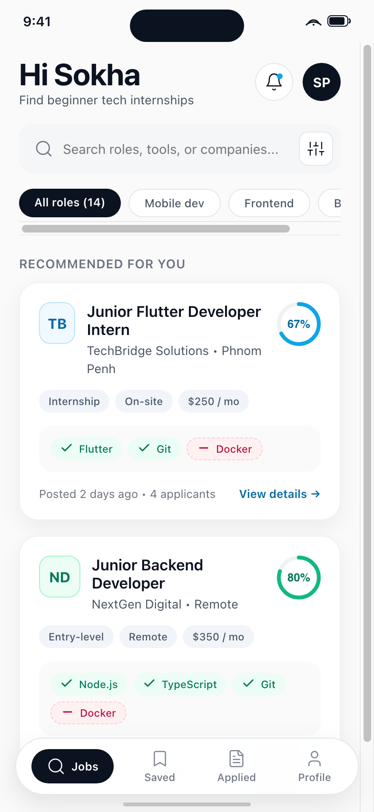
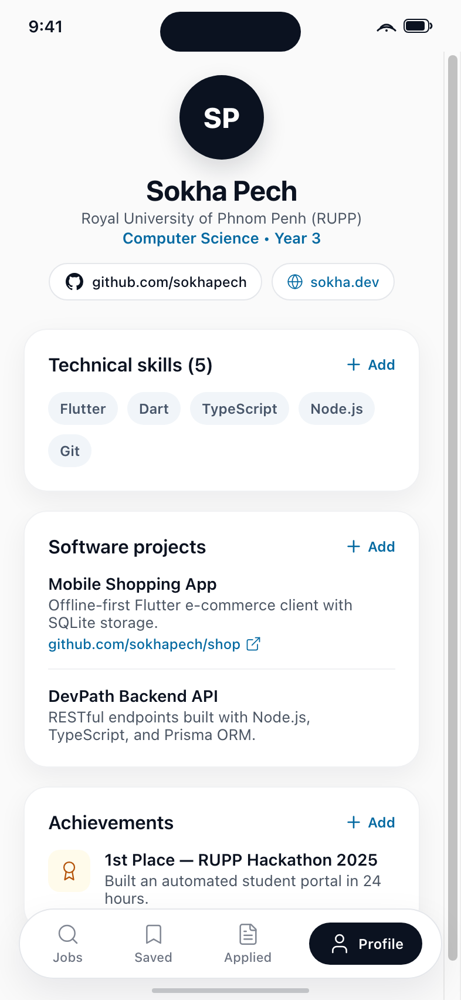

# Phase 4.1 — Figma Specifications

**Objective:** Design every screen before you build it: a small design system, your screens and a clickable prototype of your core journeys.

**Status:** Submitted · **Last updated:** 2026-11-17

| Item | Value |
|---|---|
| Figma view-only project URL | https://www.figma.com/design/otuXkH2lhb0nVRzsNo5uY7?node-id=13-2 |
| Figma interactive prototype URL | https://www.figma.com/proto/otuXkH2lhb0nVRzsNo5uY7?node-id=13-2&scaling=scale-down |
| Target frame resolution | Mobile 393×852 (iPhone 15) & Web 1440×900 (Desktop Web Portal) |

Set both links to "Anyone with the link can view" and test them in a private browser window.

## Done When

- [x] Both Figma links open in a private browser window
- [x] The Figma file has a style guide, your screens and a clickable prototype
- [x] Every screen has an ID (SCR-01, SCR-02, …) and a Figma frame with the same name
- [x] Every journey step from Phase 2.2 has a screen
- [x] 6–10 key screens are exported as PNG into `context/assets/figma/` and display in this file on GitHub

---

## 1. Visual Identity & Brand Feeling

DevPath’s visual identity is inspired by the clean, quiet, and highly confident craft of modern tools like **Linear, Vercel, Arc, and Apple**:
- **Brand Mood:** Confident, quiet, fresh. Dominated by generous white space and deep black ink, with electric sky blue (`#0EA5E9`) used sparingly as a single spark of energy.
- **Surfaces:** Candidate Mobile App (393 × 852 px, iPhone 15) and Employer Web Portal (1440 × 900 px Desktop).
- **Sentence Case Everywhere:** No raw enum identifiers (`UNDER_REVIEW` $\rightarrow$ `Under review`, `SUBMITTED` $\rightarrow$ `Submitted`).
- **Iconography:** Strict Lucide / Phosphor 1.5px stroke geometry. Zero emoji or raw text glyphs.

---

## 2. Design System Tokens

### Color System

Text must maintain a contrast ratio of at least 4.5:1 against its background (WCAG AA compliant).

| Token | Hex | Role / Used For | Contrast Ratio |
|---|---|---|---|
| **Canvas** | `#FAFAFA` | Neutral canvas background | Base |
| **Surface** | `#FFFFFF` | Cards, modals, floating bars, dropdowns | Base surface |
| **Border** | `#E5E7EB` | Structural 1px outlines and input borders | 1.3:1 against canvas |
| **Hairline** | `#F0F1F3` | Subtle internal section dividers and card edges | Divider |
| **Ink (Primary)** | `#0B1220` | Primary headings, high-emphasis text, and primary CTA buttons | 17.2:1 on White |
| **Secondary Text** | `#4B5563` | Subtitles, descriptions, company metadata | 7.1:1 on White |
| **Muted Text** | `#6B7280` | Timestamps, applicant meta, input placeholders | 4.6:1 on White |
| **Accent Sky** | `#0EA5E9` | Focus rings, match rings, active indicators, progress bars | Accent spark |
| **Accent Text / Link**| `#0369A1` | Clickable text links, breadcrumbs, detail actions | 5.8:1 on White |
| **Accent Tint** | `#F0F9FF` | Selected chip backgrounds, hero callouts, card tints | 1.1:1 against surface |

#### Semantic Soft Tints (Always soft tints with dark text, never solid fills)

| Semantic Role | Background | Text Color | Usage |
|---|---|---|---|
| **Match / Success** | `#ECFDF5` | `#047857` | Matched technical skills, high fit scores (80%+), accepted badges |
| **Skill Gap / Error** | `#FFF1F2` | `#BE123C` (dashed border) | Missing technical skills (Skill gap), input errors |
| **Under Review / Warning** | `#FFFBEB` | `#B45309` | In-review applicant status pill, warning tips |
| **Submitted / Neutral** | `#F1F5F9` | `#475569` | Initial submission status, neutral tech stack chips |

#### Optional Dark Mode Tokens
- **Dark Canvas:** `#0B0F17`
- **Dark Surface:** `#121826`
- **Dark Border:** `#1F2937`

---

### Typography

Set in **Plus Jakarta Sans** for Latin characters and numerical displays, paired with **Noto Sans Khmer** for full Cambodian localization fallback.

| Level | Size / Weight | Line Height | Tracking | Purpose |
|---|---|---|---|---|
| **Page Title** | 32 px Bold (`700`) | 38 px | -0.02em | Hero titles ("What do you build with?", "Recruitment") |
| **Section Title** | 20 px SemiBold (`600`) | 26 px | -0.01em | Major section headers ("Active job postings", "Responsibilities") |
| **Card Title** | 16 px SemiBold (`600`) | 22 px | 0em | Job titles, profile card headers ("Junior Flutter Developer Intern") |
| **Body Text** | 14 px Regular (`400`) | 22 px | 0em | Descriptions, role overviews, guide paragraphs |
| **Meta & Captions** | 12 px Medium (`500`) | 16 px | +0.01em | Timestamps, applicant counters, helper text |

---

### Shape, Depth & Radii

- **14px Radius:** Interactive controls, text inputs, buttons.
- **20px Radius:** Standard cards, job cards, dashboard KPI widgets.
- **28px Radius:** Bottom sheets, hero containers, large dialogs.
- **Fully Round (9999px):** Skill chips, status pills, avatars, floating bottom tab bar.
- **Depth & Shadows:** Soft, diffuse shadow `0 8px 24px rgba(11, 18, 32, 0.06)` with 1px hairline borders (`#F0F1F3`). No heavy outlines or dark skeuomorphic drops.

---

### Shared Component Inventory & States

| Component | Specifications & Interactive States | Done (Yes/No) |
|---|---|---|
| **Primary Button** | Ink black (`#0B1220`), white text, 14px radius, 48px height on mobile. States: Default, Hover (`#1E293B`), Focus (Sky ring), Disabled (`#E5E7EB` bg, `#9CA3AF` text), Loading. | Yes |
| **Secondary Button** | White surface, 1px `#E5E7EB` border, ink text (`#0B1220`), 14px radius. States: Default, Hover, Focus. | Yes |
| **Tertiary Button** | Text-only (`#0369A1`), no container, 600 weight. | Yes |
| **Skill Chip** | 28px height pill. Matched (`#ECFDF5` bg + check icon); Missing (dashed `#FECDD3` outline + `#FFF1F2` bg + minus icon); Neutral (`#F1F5F9` bg); Selected (`#F0F9FF` bg + `#0EA5E9` border + check icon). | Yes |
| **Signature Match Ring** | Circular SVG progress ring with round caps. Sky `#0EA5E9` default; Green `#10B981` at 80%+; Grey `#9CA3AF` under 40%. Central bold percentage. Sizes: 36px (compact), 48px (table row), 96px (hero card). | Yes |
| **Status Pill** | Soft tinted background with 6px colored dot and sentence-case text: `Under review`, `Submitted`, `Accepted`, `Rejected`. | Yes |
| **Text Inputs** | 52px height, 14px radius, filled `#F5F6F8` background, no border until focused (then 2px `#0EA5E9` ring with white surface). | Yes |
| **Mobile Bottom Nav** | Floating pill bar inset 16px from edges, blurred white background (`rgba(255,255,255,0.94)`), ink-black active pill with white icon & label. | Yes |
| **Desktop Left Sidebar** | 240px slim left rail with DevPath brand, navigation links (active ink-black filled pill with sky icon), and user card at bottom. | Yes |

---

## 3. Screen-by-Screen Catalog

| Screen ID | Screen name | Purpose | Figma frame | User journey | Endpoint |
|---|---|---|---|---|---|
| **SCR-01** | Candidate Login & Welcome | Bold hero headline "Match your skills with your first tech job." with soft sky glow, sliding segmented control, filled inputs, ink-black Sign In, and real GitHub button. | `SCR-01 / Candidate Login` | UJ-01 | EP-03, EP-04 |
| **SCR-02** | Registration & Skills Selection | Segmented progress bar, "What do you build with?" heading, search input, category skill pills (selected with sky tint + check), and sticky bottom bar. | `SCR-02 / Candidate Registration & Skills` | UJ-01 | EP-02, EP-05, EP-08 |
| **SCR-03** | Candidate Job Board & Search | "Hi Sokha" greeting with avatar and bell icon, integrated search & filter, ink category chips, job cards with compact match ring, and floating bottom nav. | `SCR-03 / Candidate Job Board` | UJ-02 | EP-10 |
| **SCR-04** | Job Details & Skill Fit Analyzer | Hero card with large 96px match ring, "You match 2 of 3 required skills", matched vs missing chip groups, sky Preparation Hub tip, and sticky bottom bar. | `SCR-04 / Job Details & Skill Fit` | UJ-03, UJ-04, UJ-07 | EP-11, EP-12, EP-14, EP-16 |
| **SCR-05** | Saved Jobs | Candidate bookmarked opportunities with quick removal and direct fit check. | `SCR-05 / Saved Jobs` | UJ-04 | EP-13, EP-15 |
| **SCR-06** | Candidate Applications Tracker | Pill-style tab switcher, application cards, and modern horizontal stepper with pulsing current-stage ring. | `SCR-06 / Candidate Applications` | UJ-07 | EP-17 |
| **SCR-07** | Preparation Hub & Guides | Curated portfolio guides and interview tips tailored to close identified skill gaps. | `SCR-07 / Preparation Hub & Guides` | UJ-05 | EP-23 |
| **SCR-08** | Candidate Profile & Portfolio | Centred avatar header with GitHub and portfolio pill links, followed by bento cards for Skills, Projects, and Achievements. | `SCR-08 / Candidate Profile` | UJ-01 | EP-06, EP-07, EP-08, EP-09 |
| **SCR-09** | Employer Login & Company Setup | Web portal recruiter authentication and company profile management. | `SCR-09 / Employer Login & Company Setup` | UJ-06 | EP-03, EP-18 |
| **SCR-10** | Employer Recruitment Dashboard | Left sidebar layout with bento row of 4 KPI cards (delta chips), and clean spacious job posting rows with mini high-fit progress bars. | `SCR-10 / Employer Job Dashboard` | UJ-06 | EP-19 |
| **SCR-11** | Employer Post a New IT Job | Form to publish junior tech openings with description, stipend, and required skill chips. | `SCR-11 / Employer Post a Job` | UJ-06 | EP-05, EP-20 |
| **SCR-12** | Employer Review Applicants | Spacious candidate row cards with match rings, matched/missing chips, status pills, and selected candidate variant (sky ring + sky tint). | `SCR-12 / Employer Review Applicants` | UJ-08 | EP-21, EP-22 |

---

## 4. Offline Asset Archive

Exported high-fidelity 2x resolution PNG screens archived in `context/assets/figma/`:

### 01 — Visual Foundations & Tokens
Design tokens, color palette, semantic tints, typography scales, radii, and iconography.

### 02 — Shared Component State Sheet
Buttons, skill chips, signature match rings, status pills, and text inputs across all interactive states.

### SCR-01 — Candidate Login & Welcome

### SCR-02 — Candidate Registration & Skills Selection

### SCR-03 — Curated Beginner IT Job Board

### SCR-04 — Job Details & Signature Skill Fit Analyzer

### SCR-06 — Candidate Applications Tracker & Stepper

### SCR-08 — Candidate Profile & Bento Portfolio

### SCR-10 — Employer Web Portal: Recruitment Dashboard (1440 Desktop)

### SCR-12 — Employer Web Portal: Review Applicants (1440 Desktop)

