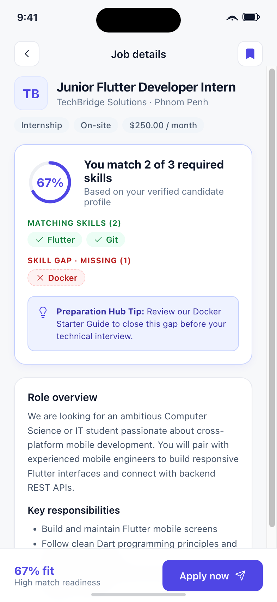
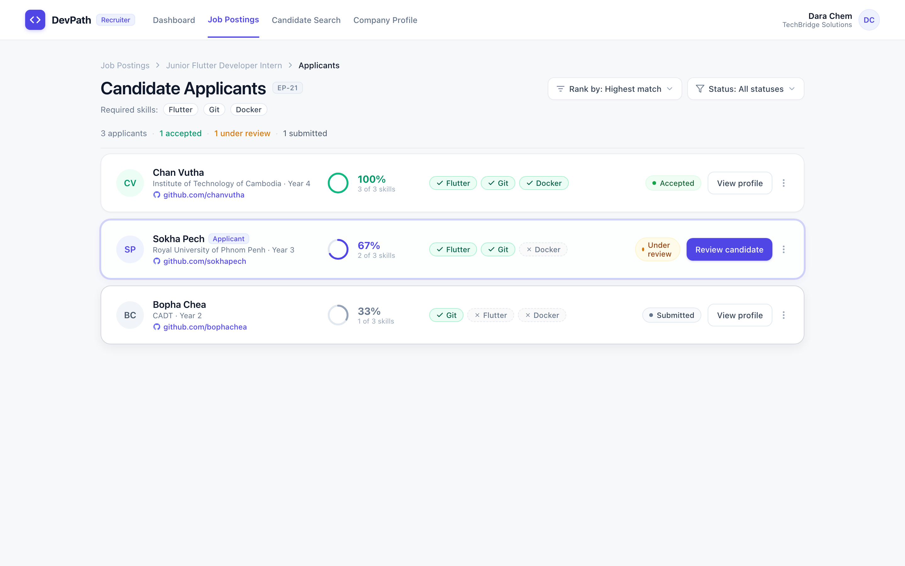
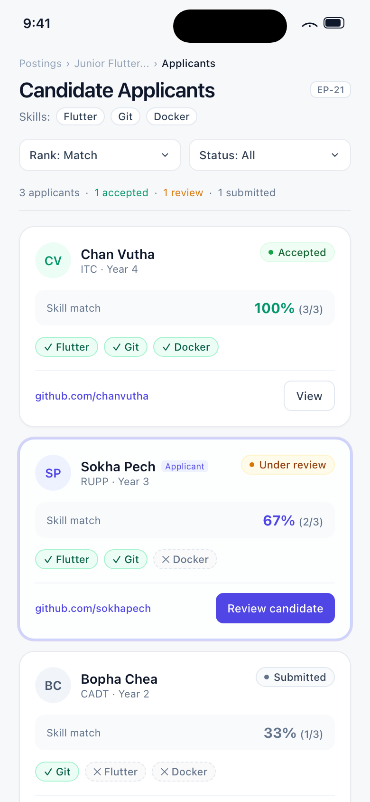

# Phase 4.1 — Figma Specifications

**Objective:** Design every screen before you build it: a small design system, your screens and a clickable prototype of your core journeys.

**Status:** Submitted · **Last updated:** 2026-11-17

| Item | Value |
|---|---|
| Figma view-only project URL | https://www.figma.com/design/otuXkH2lhb0nVRzsNo5uY7 |
| Figma interactive prototype URL | https://www.figma.com/proto/otuXkH2lhb0nVRzsNo5uY7?node-id=1-2&scaling=scale-down |
| Target frame resolution | Mobile 393×852 (iPhone 15) & Web 1280×800 (Desktop Web Portal) |

Set both links to "Anyone with the link can view" and test them in a private browser window.

## Done When

- [x] Both Figma links open in a private browser window
- [x] The Figma file has a style guide, your screens and a clickable prototype
- [x] Every screen has an ID (SCR-01, SCR-02, …) and a Figma frame with the same name
- [x] Every journey step from Phase 2.2 has a screen
- [x] 6–10 key screens are exported as PNG into `context/assets/figma/` and display in this file on GitHub

---

## 1. Your Figma File

The DevPath Figma design file is organized into four structured pages:
1. **Style Guide & Design Tokens:** Centralized color swatches, typography scales, accessibility contrast scores (all text ≥ 4.5:1), and reusable component variants with autolayout.
2. **Candidate Mobile App (Flutter):** High-fidelity mobile frames (393×852 px, iPhone 15) covering candidate onboarding, skill selection, beginner job board, automated skill gap analyzer, applications tracker, preparation hub, and profile.
3. **Employer Web Portal (Next.js):** Desktop frames (1280×800 px) for recruiter authentication, company onboarding, active job dashboard, job publishing form with required skill tags, and applicant review ranked by match percentage.
4. **Interactive Prototypes:** Interactive flows connecting the Happy Path journeys (UJ-01 through UJ-08), including skill picking, fit checking, applying, and applicant review.

---

## 2. Design System Tokens

### Color Palette

Text must have a contrast ratio of at least 4.5:1 against its background (WCAG AA compliant).

| Token | Hex | Used for | Contrast Ratio |
|---|---|---|---|
| **Primary** | `#2563EB` | Primary CTA buttons, active tab indicators, branding highlights | 4.6:1 against `#FFFFFF` |
| **Primary Dark** | `#1D4ED8` | Hover/pressed buttons, active filter text | 6.2:1 against `#EFF6FF` |
| **Secondary / Dark Slate** | `#0F172A` | Primary headings, titles, high-emphasis text, GitHub SSO button | 16.1:1 against `#FFFFFF` |
| **Background** | `#F8FAFC` | App screen background, page canvas, muted section containers | Base canvas |
| **Surface** | `#FFFFFF` | Card backgrounds, modals, input fields, navigation bars | Base surface |
| **Surface Subdued** | `#F1F5F9` | Secondary containers, table header backgrounds, disabled states | 1.1:1 against canvas |
| **Border / Divider** | `#E2E8F0` | Card borders, table dividers, input default borders | Structural outline |
| **Success (Matched Skill)** | `#15803D` (`#DCFCE7` bg) | Matching technical skills, high fit scores (&gt;65%), accepted badges | 4.8:1 against `#DCFCE7` |
| **Warning (Under Review)** | `#B45309` (`#FEF3C7` bg) | In-review application status badges, moderate fit scores (40–64%) | 4.6:1 against `#FEF3C7` |
| **Error (Skill Gap)** | `#B91C1C` (`#FEE2E2` bg) | Missing technical skills (Skill Gap), input error validation messages | 4.9:1 against `#FEE2E2` |
| **Text Secondary** | `#64748B` | Secondary descriptions, company names, timestamps, placeholders | 4.6:1 against `#FFFFFF` |

### Fonts

Typography uses the clean, highly-legible `Inter` typeface across both mobile and web clients.

| Use | Font, size and weight | Line height | Letter spacing |
|---|---|---|---|
| **Page Headings (H1)** | Inter 24 px Bold (`700` / `800`) | 32 px | -0.5 px |
| **Section Headings (H2)** | Inter 18 px Bold (`700`) | 26 px | -0.25 px |
| **Subheadings (H3)** | Inter 15 px SemiBold (`600`) | 22 px | 0 px |
| **Body Text** | Inter 13 px Regular (`400`) / Medium (`500`) | 20 px | 0 px |
| **Small / Captions** | Inter 11 px Medium (`500`) / SemiBold (`600`) | 16 px | +0.2 px |
| **Badges & Tags** | Inter 11 px SemiBold (`600` / `700`) | 14 px | +0.5 px (Uppercase) |

### Component Inventory

| Component | Variants and states | Done (Yes/No) |
|---|---|---|
| **Buttons** | Primary Blue (`#2563EB`), Dark Secondary (`#0F172A`), Outline/Ghost; states: default, pressed, disabled (`#94A3B8`), loading (spinner) | Yes |
| **Text Inputs** | Default (`#CBD5E1`), Focused (Blue border + ring `#2563EB`), Error (Red border + warning text `#DC2626`), Disabled | Yes |
| **Dropdowns & Select** | Tech Category Picker, Sort Selector, Status Action Dropdown (`UNDER_REVIEW`, `ACCEPTED`, `REJECTED`) | Yes |
| **Technical Skill Chips** | Default Slate (`#F1F5F9`), Selected Blue (`#2563EB` with checkmark), Matched Skill Green (`#DCFCE7` / `#15803D`), Missing Skill Red (`#FEE2E2` / `#B91C1C`) | Yes |
| **Job Cards** | Mobile list card with company avatar, title, stipend badge, and automated Skill Fit score summary | Yes |
| **Skill Gap Analyzer Card** | Prominent feature card with match percentage progress bar, green matching skills list, red missing skills list, and Preparation Hub tip | Yes |
| **Applicant Review Cards** | Web portal applicant row with candidate details, match percentage gauge, matched vs missing skills breakdown, and status selector | Yes |
| **Bottom Navigation** | 4-tab mobile bar: Jobs (Search), Saved, Applied, Profile with active indicator and badges | Yes |
| **Loading, empty and error states** | Shimmer skeleton cards for job loading; illustrated empty state with "No jobs found for this tech category" and "Reset Filters"; error banner with "Retry" button | Yes |

---

## 3. Screen-by-Screen Catalog

The DevPath application encompasses 12 dedicated screens spanning both the Candidate Mobile App and Employer Web Portal, covering all 8 user journeys (`UJ-01` to `UJ-08`) and all 23 API endpoints (`EP-01` to `EP-23`).

| Screen ID | Screen name | Purpose | Figma frame | User journey | Endpoint |
|---|---|---|---|---|---|
| **SCR-01** | Candidate Login & Welcome | Authenticate candidate via email/password or GitHub SSO; role toggle for candidate vs recruiter. | `SCR-01 / Candidate Login` | UJ-01 | EP-03, EP-04 |
| **SCR-02** | Candidate Registration & Skills | Account onboarding where candidate selects IT background (university, major) and tags initial technical skills. | `SCR-02 / Candidate Registration & Skills` | UJ-01 | EP-02, EP-05, EP-08 |
| **SCR-03** | Candidate Job Board & Search | Curated list of entry-level tech roles and internships with search, tech specialization pills, and match fit previews. | `SCR-03 / Candidate Job Board` | UJ-02 | EP-10 |
| **SCR-04** | Job Details & Skill Fit Analyzer | Full role description with DevPath's signature automated Skill Gap Analyzer comparing candidate skills vs requirements, with direct "Apply Now" button. | `SCR-04 / Job Details & Skill Fit` | UJ-03, UJ-04, UJ-07 | EP-11, EP-12, EP-14, EP-16 |
| **SCR-05** | Saved Jobs | Candidate bookmarked job listings saved for later review with quick removal and apply shortcuts. | `SCR-05 / Saved Jobs` | UJ-04 | EP-13, EP-15 |
| **SCR-06** | Candidate Applications Tracker | Pipeline tracking submitted applications through review stages (Submitted → Under Review → Accepted/Rejected) with match scores. | `SCR-06 / Candidate Applications` | UJ-07 | EP-17 |
| **SCR-07** | Preparation Hub & Guides | Curated portfolio structuring guides, junior technical interview tips, and learning roadmaps to close identified skill gaps. | `SCR-07 / Preparation Hub & Guides` | UJ-05 | EP-23 |
| **SCR-08** | Candidate Profile & Tech Portfolio | Comprehensive candidate profile displaying technical skills, academic details, GitHub/portfolio links, projects, experiences, and achievements. | `SCR-08 / Candidate Profile` | UJ-01 | EP-06, EP-07, EP-08, EP-09 |
| **SCR-09** | Employer Login & Company Setup | Web portal authentication for tech recruiters and company profile onboarding (name, industry, location, website). | `SCR-09 / Employer Login & Company Setup` | UJ-06 | EP-03, EP-18 |
| **SCR-10** | Employer Job Dashboard | Web portal recruitment dashboard displaying active job listings, applicant counts, high-match ratios, and quick actions. | `SCR-10 / Employer Job Dashboard` | UJ-06 | EP-19 |
| **SCR-11** | Employer Post a New IT Job | Web portal job publishing form to specify entry-level roles, stipend, descriptions, and required technical skill tags. | `SCR-11 / Employer Post a Job` | UJ-06 | EP-05, EP-20 |
| **SCR-12** | Employer Review Applicants | Web portal applicant evaluation view ranking candidate submissions by technical skill match score, displaying skill gaps, and updating hiring status. | `SCR-12 / Employer Review Applicants` | UJ-08 | EP-21, EP-22 |

---

## 4. Offline Asset Archive

Exported high-fidelity 2x resolution PNG screens saved in `context/assets/figma/` representing key touchpoints across both client platforms:

### SCR-01 — Candidate Login & Authentication
Candidate welcome screen with brand identity, role toggle, and GitHub OAuth integration.

### SCR-02 — Candidate Registration & Technical Skill Selection
Onboarding step where candidate selects programming languages, frameworks, and developer tools.

### SCR-03 — Curated Beginner IT Job Board
Candidate home feed with tech specialization filters and automated skill match previews.

### SCR-04 — Job Details & Automated Skill Fit Analyzer
Core unique value proposition: automated comparison of candidate skills vs job requirements, highlighting matched skills in green and missing skill gaps in red.

### SCR-06 — Candidate Applications Tracker
Application status tracking with pipeline milestones (Submitted, Reviewing, Decision).

### SCR-08 — Candidate Profile & Technical Portfolio
Candidate showcase featuring verified technical skills, GitHub/portfolio links, software projects, and hackathon achievements.

### SCR-10 — Employer Web Portal: Recruitment Dashboard
Recruiter desktop interface displaying active job postings, applicant counts, and recruitment metrics.

### SCR-12 — Employer Web Portal: Review Applicants & Skill Match
Recruiter evaluation view ranking candidates by match percentage with detailed skill gap breakdown, status management, and calm Linear/Vercel styling (Desktop 1440px & Mobile 390px):

